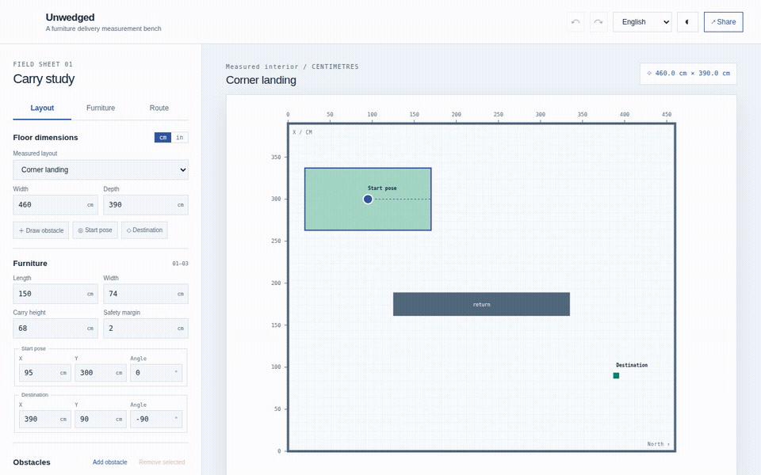

[Demo en vivo](https://arthur031221.github.io/Unwedged/) | [繁體中文](README.zh-TW.md) | [简体中文](README.zh-CN.md) | [日本語](README.ja.md) | [한국어](README.ko.md) | [Español](README.es.md) | [Français](README.fr.md) | [Deutsch](README.de.md) | [Português brasileiro](README.pt-BR.md)

# Unwedged


[](docs/install.md) [](LICENSE)

Encuentra una ruta con giros antes de que llegue el sofá.

Una herramienta local de medición para comprobar si un objeto rectangular rígido puede girar por una planta medida de una sola altura.



**Pruébalo:** abre la demo en vivo y elige Rellano en esquina. Busca y reproduce la ruta con 74 cm, y cambia después Ancho a 75 cm. Si la búsqueda limitada no encuentra ruta, eso no demuestra que el paso sea imposible.

## Inicio rápido

Instala Node.js 22.12 o posterior y Git, y ejecuta la aplicación localmente:

```sh
npx github:Arthur031221/Unwedged#v1.3.0
```

El comando descarga la aplicación y la sirve en este equipo en `127.0.0.1`. Tras la primera visita, espera al indicador «Listo sin conexión» antes de confiar en el uso sin conexión. Las medidas quedan en el navegador o en los archivos que guardes.

Unwedged modela un rectángulo rígido que se mueve en una planta. No modela 3D, escaleras, inclinación, porteadores ni deformación. La búsqueda es limitada, puede pasar por alto una ruta y no demuestra que el paso sea imposible.

X e Y indican centros. El origen está abajo a la izquierda, X aumenta hacia la derecha e Y hacia arriba. Los ángulos positivos giran en sentido antihorario. Consulta el ejemplo en [Uso](docs/usage.md).

El dibujo es el modelo. Mide lo que dibujas.

## Primer uso

1. Elige Apartment hallway, Corner landing o Blocked corridor e introduce las medidas de la habitación y los obstáculos.
2. Introduce el largo y el ancho del mueble, la altura fija de carga y el margen de seguridad. Define las posiciones y los ángulos inicial y de destino.
3. Busca una ruta y reproduce o recorre las poses devueltas. Los avisos señalan colisiones en los extremos o espacio libre inferior al margen requerido.
4. Guarda las medidas y la ruta comprobada como JSON, comparte un enlace del proyecto o exporta un plano SVG acotado.

[Uso](docs/usage.md) explica las coordenadas y la edición. [Precisión y límites](docs/accuracy.md) describe las comprobaciones geométricas y los límites de búsqueda.

## Ejemplo de cinco líneas

Guarda esto como `room.json`, ábrelo en la aplicación y elige Buscar ruta. Las dimensiones están en centímetros y los ángulos en radianes.

<!-- prettier-ignore -->
```json
{"format":"unwedged","schemaVersion":1,"project":{
  "schemaVersion":1,"name":"Small room","floor":{"width":500,"height":300},
  "furniture":{"length":150,"width":70,"height":70},"margin":2,"rects":[],
  "start":{"x":100,"y":150,"angle":0},"goal":{"x":400,"y":150,"angle":0}
}}
```

## Instalación por sistema

Instala Node.js 22.12 o posterior y Git, y ejecuta el comando en Terminal, una terminal de Linux o PowerShell. Abre la dirección que aparece y detén el servidor con Ctrl+C.

<details><summary>macOS</summary>

```sh
npx github:Arthur031221/Unwedged#v1.3.0
```

</details>

<details><summary>Linux</summary>

```sh
npx github:Arthur031221/Unwedged#v1.3.0
```

</details>

<details><summary>Windows</summary>

```powershell
npx github:Arthur031221/Unwedged#v1.3.0
```

</details>

## Archivos del proyecto

- `src/core/geometry.ts` calcula las huellas orientadas, los huecos de las puertas y el espacio físico disponible.
- `src/core/verify.ts` certifica cada intervalo de movimiento mediante límites continuos adaptativos.
- `src/core/search.ts` ejecuta una búsqueda A* determinista con límites finitos de estados y tiempo.
- `src/worker.ts` ejecuta la búsqueda y la verificación de rutas importadas fuera del hilo de la interfaz.
- `src/locales` contiene nueve traducciones de la interfaz.
- [docs/accuracy.md](docs/accuracy.md) describe las comprobaciones geométricas y los límites del solucionador.

## Desarrollo

Desde una copia del repositorio, ejecuta `npm ci`, `npm run dev`, `npm test` y `npm run build`. [CONTRIBUTING.md](CONTRIBUTING.md) enumera las comprobaciones de navegador, modo sin conexión, paquetes y Shapely independiente. Se incluyen las fuentes y sus avisos OFL.

Assisted by Claude/Codex.
